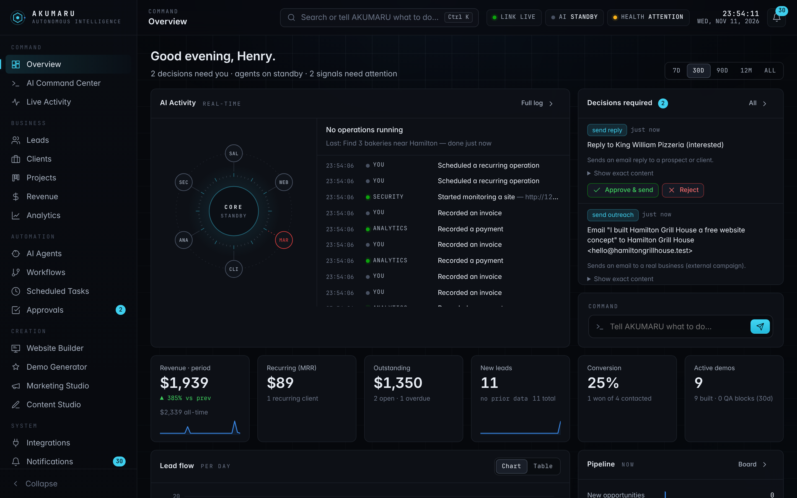
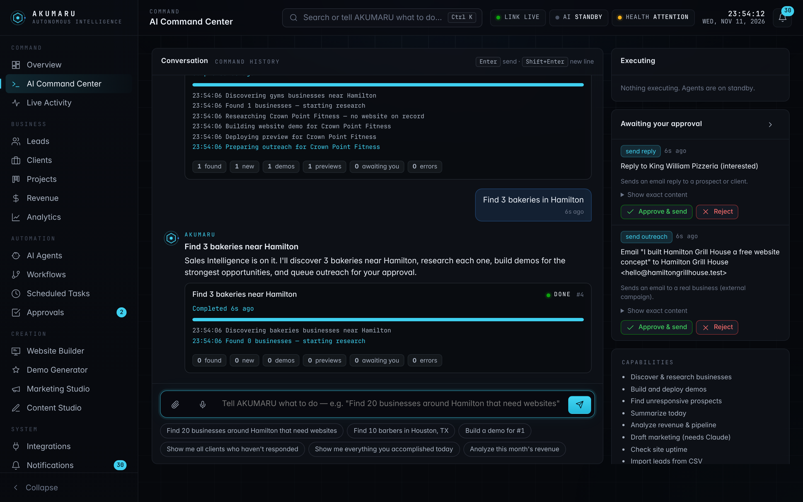
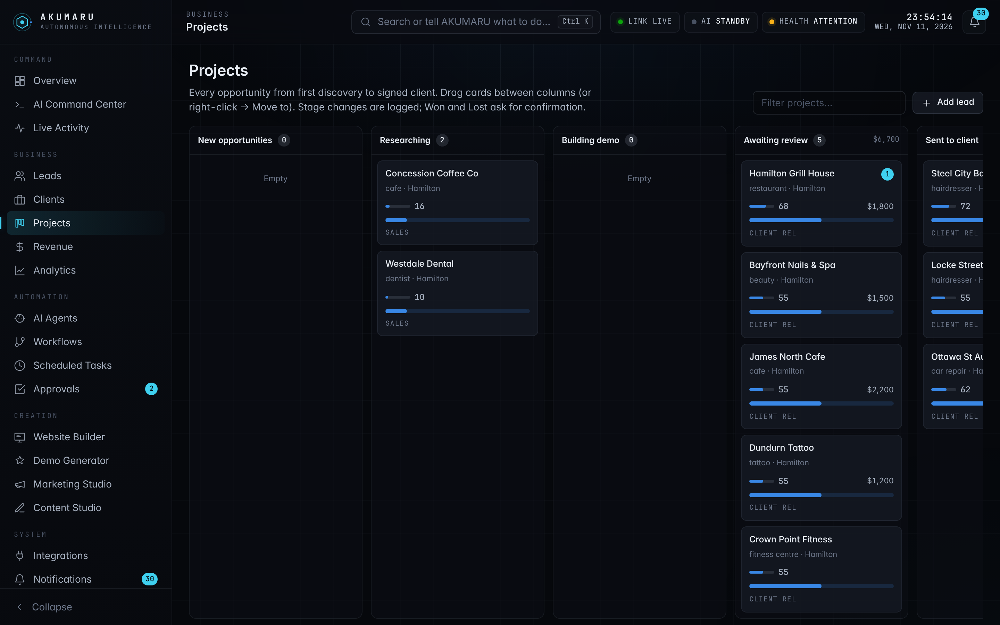
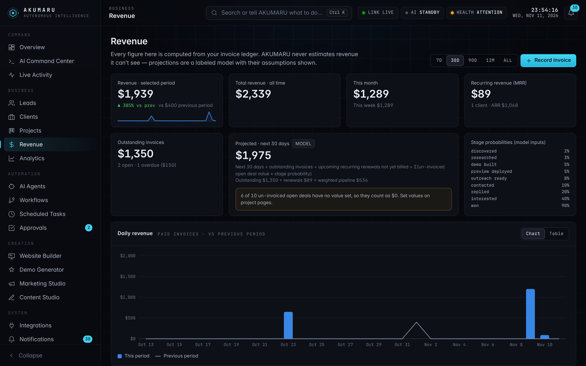
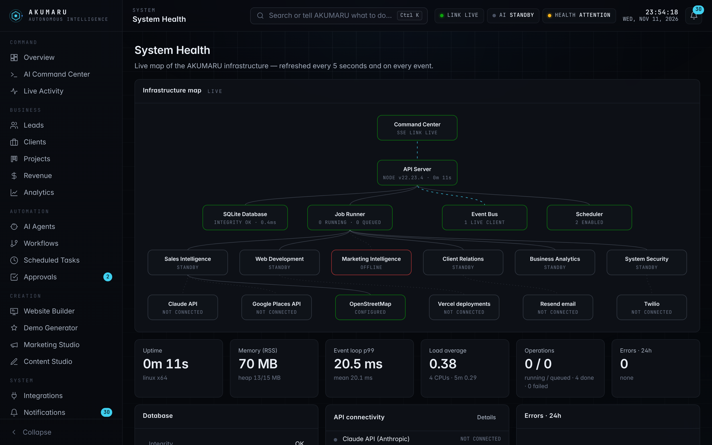
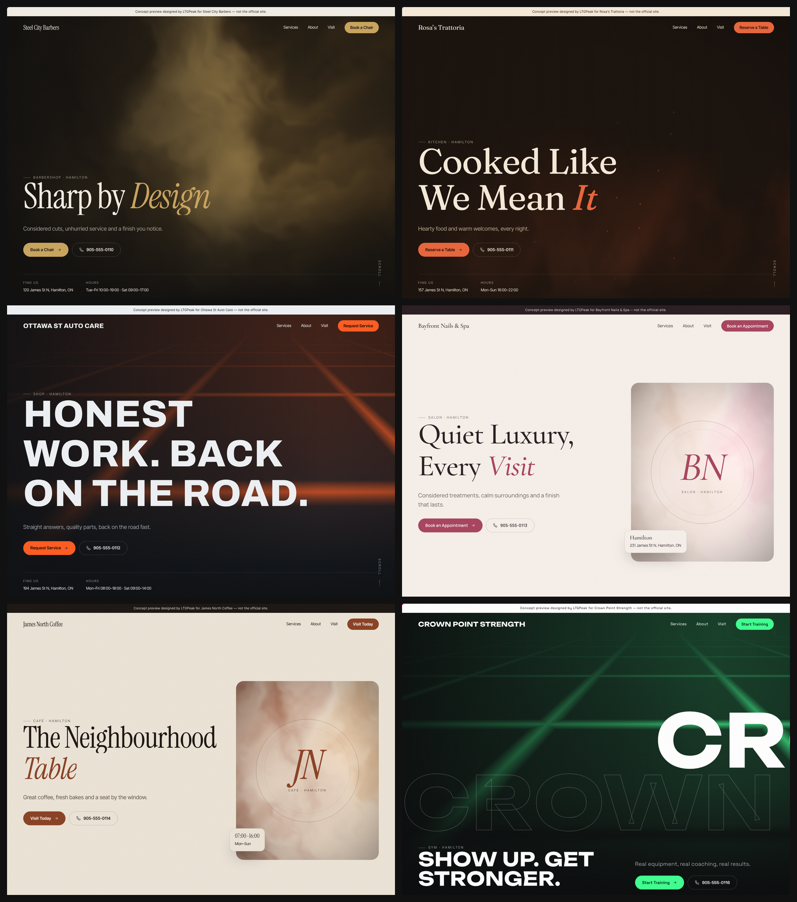
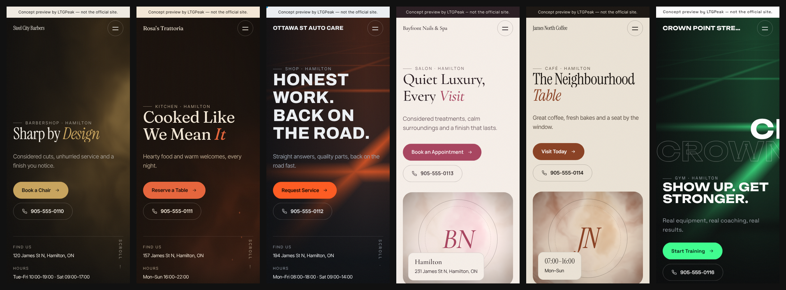

# Akamaru — LTGPeak Autonomous Business OS

Akamaru finds local businesses, researches their real web presence, builds each one a
personalized website demo, deploys a preview, drafts outreach grounded in what it found,
and manages replies and onboarding. **Anything external or binding (sending email,
publishing a live site, payments, contracts) waits in an approval queue for the owner.**

## AKUMARU Command Center

`npm start`, then open http://127.0.0.1:4317. This is the control room: 20 pages covering live AI activity, the decision queue, a natural-language command interface, a Kanban project board, revenue and analytics, agent status, workflows, schedules, the creation studios, integrations, notifications and system health.



*The screenshots were taken with sample data run through the real pipeline against local stand-in websites. The invoices in them are labeled SAMPLE.*

**Every element shows real data or says it has none.**
- Revenue comes only from the invoice ledger.
- The revenue projection is labeled as a model, and its assumptions are shown on the page.
- Agents that are missing an integration show as offline, with instructions to connect them.

The details are in [docs/modules/command-center.md](docs/modules/command-center.md).

| | |
|---|---|
|  |  |
|  |  |

## Demo websites: art-directed, not templated

Every prospect gets a custom concept site. For each business:
- **Direction:** the creative director weighs **12 design systems** (each with its own type pairing, graded palette, hero composition and service layout), keeps three distinct candidates, and picks the strongest with a written rationale.
- **Imagery:** the business's real photos are used first, then AI concept imagery from detailed art-direction briefs (when connected), never stock.
- **Motion:** GSAP, scroll storytelling and a WebGL light field, with fonts and scripts self-hosted.
- **QA:** Itachi checks every site in a real browser at 375–1920px before it can ship.




*These six demos were generated without any photography, which is the common case for businesses with no website. With Google Places or a business website, their real photos fill the hero, gallery and service showcases. Details: [docs/modules/design-engine.md](docs/modules/design-engine.md).*

The eight Akamaru branches are real modules:

| Branch | Role | Module |
|---|---|---|
| **Akamaru** | Front door: CLI + dashboard | `bin/akamaru.js`, `src/server.js`, `public/` |
| **Tsunade** | Orchestrator, runs the pipeline | `src/branches/tsunade-orchestrator.js` |
| **Jiraiya** | Discovery + website research | `src/branches/discovery.js`, `jiraiya-research.js` |
| **Clavo Dulce** | Opportunity scoring (explainable) | `src/branches/clavo-score.js` |
| **Orochimaru** | Demo site builder + deploys | `src/branches/orochimaru-demo.js`, `deploy.js` |
| **Itachi** | QA gate (no failed demo is ever pitched) | `src/branches/itachi-qa.js` |
| **Kakashi** | Outreach, reply handling, won deals | `src/branches/kakashi-outreach.js` |
| **Decision engine** | Autonomous vs. owner approval | `src/decision.js` |

## Quick start

Requires Node.js ≥ 22.13 (uses built-in `node:sqlite`, so there are no native builds).

```bash
npm install
cp .env.example .env      # fill in what you have; everything is optional
npm run doctor            # shows what's connected and how to connect the rest
npm start                 # dashboard at http://127.0.0.1:4317
```

```bash
# Full autonomous run: discover → research → demo → QA → preview → outreach draft
node bin/akamaru.js run --category barber --near "Houston, TX" --limit 10

# Or add a lead by hand and process it
node bin/akamaru.js add --name "Fresh Fade Barbers" --category barber --city Houston --email owner@freshfade.com
node bin/akamaru.js process 1

# Review and approve what Akamaru wants to send
node bin/akamaru.js approvals
node bin/akamaru.js approve 1
```

Run `node bin/akamaru.js` with no arguments to see every command.

## Pipeline stages

`discovered → researched → demo_built → preview_deployed → outreach_ready → contacted → replied → interested → won → onboarding → active` (plus `lost`, `do_not_contact`).

## Integrations

| Integration | Needed for | Without it |
|---|---|---|
| `ANTHROPIC_API_KEY` | AI research summaries, demo copy, outreach, reply classification | Template copy + keyword classifier built only from real data |
| `GOOGLE_PLACES_API_KEY` | Best-quality discovery | OpenStreetMap discovery (no key) |
| `VERCEL_TOKEN` | Public preview URLs | Previews served by the dashboard at `/preview/…` |
| `RESEND_API_KEY`, `OUTREACH_FROM_EMAIL`, `OUTREACH_BUSINESS_ADDRESS` | Sending approved email | Drafts are queued; nothing is sent |
| `AKAMARU_WEBHOOK_SECRET` | Receiving replies at `POST /api/inbound` | Log replies with `akamaru inbound` |
| `AKAMARU_ADMIN_TOKEN` | Exposing the dashboard beyond localhost | Dashboard binds to 127.0.0.1 only |
| `IMAGE_PROVIDER` + `OPENAI_API_KEY` or `REPLICATE_API_TOKEN` | AI concept imagery for demos | Real photos (Places / their site) or photo-free composition |
| `TWILIO_*` + `OWNER_PHONE` | SMS / phone-call alerts for critical notifications | Alerts stay in the dashboard |

`npm run doctor -- --live` also probes whether each API is reachable from your network.

## Tests

```bash
npm test
```

The external APIs (OSM, Google Places, Vercel, Resend, Claude) are tested against local
stub servers that check each provider's real request contract. That proves the request
shape, not live connectivity. Live connectivity is verified with `doctor --live` once
keys are set.

The browser tests in `test/ui.test.js` run when Playwright is installed (`npm i -D playwright`) and skip otherwise.

See [docs/ROADMAP.md](docs/ROADMAP.md), [docs/DEVLOG.md](docs/DEVLOG.md) and [docs/modules/](docs/modules/).
